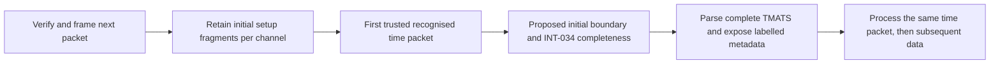

# Initial TMATS closure at the first time packet: proposed INT-045

Date: 2026-11-23. Status: source investigation and proposal only. Owner
streaming-use decision: NOT made. Owner sign-off and independent AI review
of INT-045: pending. No implementation or completed development analysis.

## What the standard says

Verified directly in the publisher's 106-24R1 Chapter 11 PDF, January 2025:

- Section 11.2.3.2, printed p. 11-24: "A time data packet shall be the first
  dynamic data packet at the start of each session. Only static
  Computer-Generated Data, Format 1 packets may precede the first time data
  packet." It also requires at least one time packet when the source is NONE.
- Section 11.2.3.3, p. 11-26, repeats the first-dynamic/only-static rule for
  Format 2 network time, saying recording rather than session.
- Section 11.2.7.2, p. 11-50: the new setup record is committed "prior to any
  new or changed data packets being committed to the stream". The preceding
  condition is a setup-record configuration change with SRCC set to 1.
- The event requirement is on **p. 11-51**, not p. 11-50: "Prior to the new
  setup record being committed to the stream, a setup record configuration
  change event packet shall be inserted into the stream."

The first-time ordering is explicit. Treating that observation as an assembly
closure signal is our proposed inference, not a printed end-of-record marker.
It does not prove undamaged text, a valid clock or a unique governing record.

## Older-edition check: 106-07 through the baseline

Read the actual RCC chapter PDFs linked below, not reference implementation
code. Page numbers are printed pages. Time rule is in section 10.6.3.2
through 106-15 and 11.2.3.2 thereafter; Format 2 is section 11.2.3.3.

| Edition/source | First-time ordering, Format 1 / Format 2 pages | Update/event passages |
| --- | --- | --- |
| [106-07 Ch10](https://www.irig106.org/docs/106-07/chapter10.pdf) | 10-46 / not defined | 10.6.7.2 pp. 10-71–72 defines initial setup and SRCC; later editions' quoted commit/event requirements are absent from that setup section |
| [106-09 Ch10](https://www.irig106.org/docs/106-09/chapter10.pdf) | 10-44 / not defined | 10.6.7.2 p. 10-68: both commit-before-changed-data and preceding event |
| [106-11 Ch10](https://www.irig106.org/docs/106-11/chapter10.pdf) | 10-44 / not defined | p. 10-68: both; event/commit notes are printed among the 10.6.7.2–3 material |
| [106-13 Ch10](https://www.irig106.org/docs/106-13/chapter10.pdf) | 10-41 / not defined | 10.6.7.2 p. 10-63: both |
| [106-15 Ch10](https://www.irig106.org/docs/106-15/chapter10.pdf) | 10-41 / not defined | 10.6.7.2 p. 10-64: both |
| [106-17 Ch11](https://www.irig106.org/docs/106-17/chapter11.pdf) | 11-20 / 11-23 | 11.2.7.2 p. 11-45: both |
| [106-19 Ch11](https://www.irig106.org/docs/106-19/chapter11.pdf) | 11-23 / 11-25 | 11.2.7.2 p. 11-47: both |
| [106-20 Ch11](https://www.irig106.org/docs/106-20/chapter11.pdf) | 11-23 / 11-25 | 11.2.7.2 p. 11-47: both |
| [106-22 Ch11](https://www.irig106.org/docs/106-22/chapter11.pdf) | 11-24 / 11-26 | 11.2.7.2 pp. 11-50–51: both |
| [106-23 Ch11](https://www.irig106.org/docs/106-23/chapter11.pdf) | 11-24 / 11-26 | 11.2.7.2 pp. 11-50–51: both |
| [106-24 Ch11](https://www.trmc.osd.mil/wiki/download/attachments/351465801/chapter11.pdf?api=v2) | 11-24 / 11-26 | 11.2.7.2 pp. 11-50–51: both |
| [106-24R1 Ch11](https://www.trmc.osd.mil/wiki/download/attachments/335389015/chapter11.pdf?api=v2) | 11-24 / 11-26 | 11.2.7.2 pp. 11-50–51: both |

Every checked edition has the initial ordering rule. Earlier wording says
recording; Format 1 from 106-17 says session. Do not assume a split file or
arbitrary network attachment begins a recording/session. The proposal needs
known start provenance; multi-file session reconstruction is not solved here.
The IRIG site serves copies of the RCC publications; 106-24/R1 above are
publisher downloads. The IRIG 106-24 URL returned HTML and was not used as
PDF evidence. The printed 106-13 heading identifies the published June 2013
edition despite its PDF metadata title saying "2013 Pink sheet V0.9".

## Precisely which packet could close the initial runs

Table 11-4, 106-24R1 pp. 11-6–7, identifies header data types 0x11 as Time
Data Format 1 and 0x12 as Time Data Format 2 (Network Time). 0x10 and
0x13–0x17 are reserved. The latter row's printed format-name range overlaps
Format 2; use its explicit reserved byte range, not a guessed extra format.

Older table checks: 106-07 Table 10-7 p. 10-35; 106-09 Table 10-7 p. 10-32;
106-11 Table 10-7 p. 10-33; 106-13/15 Table 10-10 p. 10-27 all define 0x11
and reserve 0x12–0x17. Table 11-4 from 106-17 defines 0x12 (p. 11-6 in
106-17/19/20; pp. 11-6–7 in 106-22 onward). Thus 0x12 is eligible only
under an applicable reviewed 106-17-or-later packet-format binding. Unknown
edition/version support is unavailable, not permission to guess a mapping.
Packet Data Type Version, setup RCCVER and G\106 remain separate code spaces.

Proposed guards and effect (Option A, recommended):

1. Know the recording/session start and retain packet-order/trust evidence.
   Observe a prefix containing only static 0x01 setup packets. Any known
   prior dynamic, non-setup or untrusted/unreadable packet defeats automatic
   positive use of this clean-prefix inference; preserve/report the violation.
2. At the **first structurally trusted, edition-recognised 0x11 or 0x12
   packet, on ANY channel**, seal the initial candidate runs immediately
   before that packet. Verify framing, bounds and applicable packet checksums
   through the reader contract; a corrupt marker is not positive evidence.
   Valid clock synchronisation or an available absolute time is not required:
   source NONE still counts. Semantic time-content findings remain separate.
3. Retain each channel's bytes/provenance separately, with this session-level
   boundary's offset, packet identity/type, source citation and reason.
   Do not include the time packet in TMATS, mix channels, invent a missing
   setup record or choose which of several channel descriptions governs.
4. Apply INT-034 independently. Cut text, missing/untrusted fragments, XML
   and duplicate/split ambiguity are not repaired by the boundary. Only a
   supported, complete, sufficiently unambiguous description is eligible for
   the separately reviewed consumer/governance policy; no early-data backfill
   or first/last candidate selection is implied.

A secondary-header timestamp, IPTS, NTP frame inside an Ethernet packet,
TMATS TFMT field, reserved type, or merely a later periodic time packet is
not this signal. No clock value or time-source association is inferred.

Ordering violations: retain candidates and bytes, report the offending prefix
and missing/unknown start evidence, and withhold authoritative automatic
adoption from this inference. A forensic caller policy would need its own
labelled assumption. If no time packet arrives, a live run remains open/
provisional within its memory budget. At actual EOF, use INT-034's labelled
EOF classification; a clean boundary-ending TMATS record can be Complete
while the recording separately violates the required time-packet ordering.
A temporary pause, resource limit or source NONE never manufactures EOF.

## A single-pass pipeline and why the earlier draft waited

The reader holds the triggering packet for dispatch, not a whole-file copy
or a second scan. It can deliver TMATS before decoding that time packet and
later channels. Closing a TMATS byte domain also avoids waiting for the whole
recording to compute its digest, subject to existing checksum/assembly gates.
The initial boundary gives no evidence for data-channel-to-time-source links.

Why did EOF appear necessary? Under the earlier strict INT-011 interpretation,
other-channel data never stopped an idle setup channel's run; if that channel
never emitted another packet, it stayed open to EOF. That was a model gap,
not a standard requirement to read an entire file. This proposal adds a
specific initial phase boundary rather than choosing provisional semantic
use for all open records. The diagram describes the recommended proposal,
not implemented or approved behavior. Damaged/partial inputs still need
explicit uncertainty and bounded buffering.

## Mid-session updates do not have the same universal signal

The commit-before-new/changed-data requirement establishes ordering, not an
observable record length or end marker. Unchanged channels may continue;
a periodic time packet may belong to unaffected traffic. Determining which
packet is "new or changed" can itself require the new TMATS and a known
record boundary. Treating the next data/time packet as closure is circular
and unsupported by the first-time rule, which applies only to the beginning.

The configuration-change event is specified **before** the new setup record,
not after its last fragment. Its identity remains unverified (approved
INT-030/F7); no nearby 0x02 recording-event packet is promoted to that event.
An independently verified event could help delimit a new phase later, but
neither its current unknown identity nor SRCC supplies an end marker here.

Accordingly, a mid-session run stays open/provisional until another justified
boundary exists: existing same-channel joining stop, actual EOF, or a future
reviewed external/consumer contract. A labelled provisional snapshot policy
could make it usable sooner, but remains undecided. This initial-only proposal
does not approve INT-028/031 governance, mid-session snapshots or timelines.

## Interaction with existing interpretations and owner options

INT-011 is approved and unchanged by this draft. **If adopted, INT-045 would
qualify its absolute other-channel-never-stops wording** with one explicit
session-level initial boundary; reconciling those requirements/ADRs must be
reviewed before implementation. Ordinary per-channel joining remains
independent. Calling this a separate layer must not hide that sealing ends
the initial run and prevents joining later same-channel fragments into it.

INT-034 still decides completeness after closure; its same-channel ordinary
stop and labelled EOF rules stay intact. The proposed initial-time reason
would be additional, not relabelled "followed by a same-channel packet".
Leading truncation, ambiguous runs and multiple candidate descriptions still
block unqualified use. INT-039 counts duplicates within one established
document, even across fragments. A later setup record after this boundary is
a separate candidate, never appended to make its G\PN/G\106 duplicate the
initial record. Conversely repeated scalars before the boundary remain
duplicate/split evidence; this signal cannot choose among multiple records
in the prefix. Mid-session adjacent records remain their own ambiguity work.

**Owner summary:** the standard puts initial TMATS before the first time
packet. We can propose using that time packet as a narrowly justified end of
the initial setup phase, then process the recording once, in order. It does
not justify doing the same at every later time/data packet.

- **Option A, recommended:** guarded first-time initial closure, with explicit
  trust/start/order evidence and unchanged completeness checks. Solves normal
  initial streaming without approving speculative mid-session snapshots.
- **Option B:** retain current per-channel/EOF-only finality and consider
  explicit provisional semantic snapshots separately. More uniform but can
  delay initial semantic use until EOF despite the initial-order evidence.
- **Option C:** infer every mid-session update ends at the next data/time
  packet. Not recommended: changed versus unchanged traffic is not a universal
  observable marker and the event is preceding, not a terminator.

No option is selected. INT-045 needs owner sign-off and an independent AI
check; intensive tests, source freshness and full development analysis remain.

## Source fingerprints and limits of this check

SHA-256 identifies each downloaded chapter inspected above. PDFs and
extracted text stayed in temporary research storage, outside this repository;
no other repository was accessed. Normalised text was searched and relevant
printed-page passages/table rows read; source inspection is not an executed
parser/assembler test. This is a focused 106-07-through-24R1 investigation,
not full development analysis across every edition/handbook or future formats.

| Chapter PDF | SHA-256 |
| --- | --- |
| 106-07 | `50d125bc744001d803dcb8cadcb5c2038940ca980098afeb0ebcd25601d8e582` |
| 106-09 | `1f93423591c43277009762c31c816358aead90bea9b570a4afc4c68e84ee0ec6` |
| 106-11 | `8cef16928df5d3f93dfff6f95806e9923b41927413090b0844bf28313065c7a7` |
| 106-13 | `aeed3ed5e33350e2a3e963809a934c2026113610c2608f56c62f6955bec79aa4` |
| 106-15 | `cace968a4a796a56895eff36073840ae2db3a9c57dd33794d0c348e95fe0c204` |
| 106-17 | `7297c782e0368e72ac783a72edccaa04eed28a8ea0e8ab7c61ea39379f516750` |
| 106-19 | `ac06990ab1b98594cf70fd82815ae2d1efb6d7fb58bf329cf2dcc71a8b64ad9d` |
| 106-20 | `add183f230d51a780c14d57e2dc04a724ce09fa25e09e1329f7e3e436e43fe52` |
| 106-22 | `e3e85ed09ddec95d49e9e1851ac4234b5df35b6340d9d91f355b1c598543d0a6` |
| 106-23 | `ed30d02fe27cd89d9172ada824251fd6cd748bc87cb63c15f371152fa3274781` |
| 106-24 | `d26e7926f4b2e7977df5e6210044cfc0d4c1191d45a66b71da2d530bf68de6a8` |
| 106-24R1 | `0f63792dcac39f6010df371ee0afc46a396017918f4155cba9ebab6c2d6d263e` |
